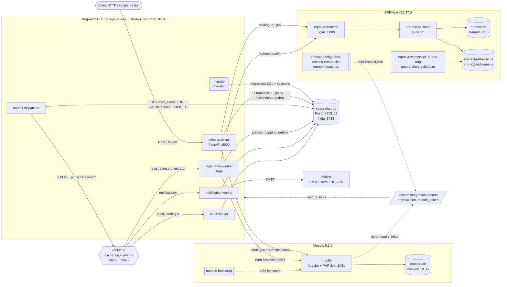

# OpenTraining : mini SI intégré (Moodle + ERPNext + Integration Hub)

Projet de synthèse EPSI. OpenTraining est un organisme de formation fictif. Une inscription reçue par
l'API doit produire trois effets cohérents :

- dans **Moodle** (LMS) : un compte apprenant inscrit au cours ;
- dans **ERPNext** (CRM + ERP) : un Lead, un Customer et un Sales Order soumis ;
- un **email** de confirmation (Mailpit).

Ces effets ne doivent jamais apparaître en double ni être perdus, même en cas de panne d'un système
externe, de crash d'un worker, de message RabbitMQ dupliqué ou de requêtes concurrentes sur la dernière
place.

L'**Integration Hub** (FastAPI + workers Python) coordonne l'ensemble. Il dispose de sa propre base
PostgreSQL (places, statuts, outbox, déduplication, correspondance des identifiants) et communique par
événements via RabbitMQ. Il ne touche jamais aux bases de Moodle ou d'ERPNext : il passe uniquement
par leurs API officielles (Web Services REST Moodle, API REST Frappe).

## Sommaire

1. [Architecture](#1-architecture)
2. [Prérequis](#2-prérequis)
3. [Démarrage pas à pas](#3-démarrage-pas-à-pas)
4. [Services Docker Compose](#4-services-docker-compose)
5. [Démo et tests](#5-démo-et-tests)
6. [API et codes HTTP](#6-api-et-codes-http)
7. [Appels réellement faits à Moodle et ERPNext](#7-appels-réellement-faits-à-moodle-et-erpnext)
8. [Événements et versionnement](#8-événements-et-versionnement)
9. [Sécurité](#9-sécurité)
10. [Limites connues et choix assumés](#10-limites-connues-et-choix-assumés)
11. [Arborescence](#11-arborescence)

---

## 1. Architecture



Le compose démarre aussi `erpnext-configurator` et `erpnext-create-site`, deux jobs one-shot repris du
`pwd.yml` officiel de frappe_docker (voir `docker-compose.yml`).

**Trajet d'une inscription** :

1. `POST /api/v1/registrations` ouvre une seule transaction PostgreSQL qui réserve l'`Idempotency-Key`,
   verrouille la session (`SELECT … FOR UPDATE`), décrémente les places, crée l'inscription (`ACCEPTED`)
   et écrit l'événement `registration.accepted` dans `outbox_event`. Réponse `202`.
   Voir `integration-api/app/registrations.py`.
2. `outbox-dispatcher` publie l'événement dans l'exchange topic `si.events`, attend la confirmation du
   broker, puis marque `published_at`. Voir `workers/outbox/main.py`.
3. `registration-worker` exécute la saga : Lead et Customer ERPNext, utilisateur et inscription Moodle
   (`MOODLE_ENROLLED`), Sales Order soumis (`ERP_RECORDED`), puis `CONFIRMED` avec l'événement
   `registration.confirmed` écrit dans l'outbox. Voir `workers/registration/processor.py`.
4. `notification-worker` envoie l'email et `audit-worker` journalise tous les événements dans `audit_log`.

**Statuts d'une inscription** (`migrations/001_init.sql`) : `ACCEPTED`, `PROCESSING`, `MOODLE_ENROLLED`,
`ERP_RECORDED`, `CONFIRMED`, `RETRYING`, `COMPENSATING`, `COMPENSATED`, `FAILED`. Chaque transition est
enregistrée dans `registration_status_history` et renvoyée par `GET /api/v1/registrations/{id}`.

**Topologie RabbitMQ** (déclarée en code par chaque service au démarrage, `shared/rabbit.py`) :

| Queue | Type | Routing keys | Consumer |
|---|---|---|---|
| `registration.orchestrator` | quorum, `x-delivery-limit` 10 | `registration.accepted` | registration-worker |
| `notifications` | quorum, `x-delivery-limit` 10 | `registration.confirmed`, `registration.compensated`, `registration.failed`, `notification.requested` | notification-worker |
| `audit` | quorum, `x-delivery-limit` 10 | `#` | audit-worker |
| `<queue>.retry.2s` / `.4s` / `.8s` | classique, TTL | exchange `si.events.retry` | retour à `<queue>` à expiration |
| `registration.dlq`, `notifications.dlq`, `audit.dlq` | classique durable | exchange `si.events.dlx` | inspection manuelle |

Aucun service ne publie `notification.requested` pour l'instant : le binding et le rendu existent
(`workers/notifications/main.py`) mais ce type n'est pas émis.

---

## 2. Prérequis

| Élément | Détail |
|---|---|
| Docker Desktop (ou Docker Engine + plugin Compose v2) | Commande `docker compose`. Sous Windows, backend WSL2. |
| Mémoire | **8 Go minimum alloués** à WSL2/Docker (ERPNext compte à lui seul 9 conteneurs). Sous Windows, régler `memory=8GB` dans `%UserProfile%\.wslconfig`, puis `wsl --shutdown`. |
| Ports libres sur l'hôte | `8000` (API), `8080` (ERPNext), `8081` (Moodle), `5433` (PostgreSQL d'intégration), `5672` et `15672` (RabbitMQ), `8025` et `1025` (Mailpit). Tous sont modifiables dans `.env`. |
| Python 3.12+ | Uniquement pour `scripts/init-env.py` et le venv des scripts de test (l'image du Hub embarque son propre Python 3.12, voir `Dockerfile`). |
| Git Bash (Windows) | Pour exécuter les scripts `.sh` (`check-infra.sh`, `reset-integration.sh`, `test-db-down.sh`…). |
| `curl` | Utilisé par `scripts/check-infra.sh` et `scripts/test-db-down.sh` (fourni avec Git Bash). |
| Accès Internet au premier build | Téléchargement des images, `git clone` de Moodle v5.3.0 et `composer install` (`infra/moodle/Dockerfile`). |

---

## 3. Démarrage pas à pas

Toutes les commandes se lancent depuis la racine du dépôt, dans Git Bash sous Windows.

### 3.1 Cloner et générer le `.env`

```bash
git clone https://github.com/KJerem/projet_api_erp.git
cd projet_api_erp
python scripts/init-env.py
```

`scripts/init-env.py` copie `.env.example` vers `.env` et remplace chaque valeur `change-me` par un
mot de passe aléatoire (`secrets.token_urlsafe`). Le script refuse d'écraser un `.env` existant, sauf avec
`--force`. Le fichier `.env` est ignoré par Git (`.gitignore`).

### 3.2 Construire et démarrer la stack

```bash
docker compose up -d --build
```

Prévoir **environ 4 à 5 minutes** au premier démarrage, une fois les images téléchargées et construites.
Les étapes qui prennent le plus de temps sont la création du site ERPNext, le setup wizard et
l'installation de Moodle.

Suivre les jobs d'initialisation :

```bash
docker compose logs -f erpnext-create-site erpnext-bootstrap moodle moodle-bootstrap migrate
docker compose ps -a
```

Les jobs one-shot (`erpnext-configurator`, `erpnext-create-site`, `erpnext-bootstrap`,
`moodle-bootstrap`, `migrate`) doivent finir en `Exited (0)`. Le `registration-worker` ne démarre
qu'après la réussite des deux bootstraps (`depends_on … service_completed_successfully`).
Les bootstraps écrivent des logs JSON. Le dernier message attendu est `bootstrap ERPNext terminé` pour
l'un, `bootstrap Moodle terminé` pour l'autre.

Ce que fait l'initialisation :

| Job | Effet | Fichier |
|---|---|---|
| `erpnext-create-site` | Crée le site `frontend`, installe ERPNext et fixe l'`encryption_key` dès la création | `docker-compose.yml` |
| `erpnext-bootstrap` | Termine le setup wizard (société, EUR, France), génère les clés API, crée les articles et prix de `infra/catalog.json` | `infra/bootstrap/bootstrap_erpnext.py` |
| `moodle` (entrypoint) | Installe Moodle en CLI, active les Web Services REST, crée le service `opentraining_integration` et écrit le token | `infra/moodle/50-opentraining-setup.sh`, `infra/moodle/setup_ws.php` |
| `moodle-bootstrap` | Crée les cours de `infra/catalog.json` via les Web Services | `infra/bootstrap/bootstrap_moodle.py` |
| `migrate` | Applique `migrations/*.sql` et crée les sessions du catalogue | `shared/migrate.py` |

Tous ces jobs sont idempotents : un second `docker compose up -d` ne recrée rien.

### 3.3 Créer le venv des scripts (pendant le démarrage)

Les scripts Python côté hôte tournent **dans le venv du projet**, jamais avec le Python global.

```bash
python -m venv .venv
.venv/Scripts/python -m pip install -r requirements-dev.txt   # Windows
# .venv/bin/python -m pip install -r requirements-dev.txt     # Linux / macOS
```

### 3.4 Vérifier l'infrastructure

```bash
bash scripts/check-infra.sh     # utilise automatiquement .venv/Scripts/python (ou .venv/bin/python)
```

Le script vérifie chaque système par son API officielle, avec les credentials générés : token ERPNext,
`Customer` et `Item Price` ERPNext, `core_webservice_get_site_info` et le cours `PYTHON-ADV` dans Moodle,
API de management RabbitMQ, `pg_isready` sur la base d'intégration et API Mailpit. Résultat attendu :
`8 PASS / 0 FAIL`.

Vérifier aussi l'API : `curl http://localhost:8000/ready` doit renvoyer `{"status":"UP",…}`.

### 3.5 Tests unitaires (sans Docker)

`requirements-dev.txt` inclut les dépendances du Hub (`-r requirements.txt`) : les tests importent son code.

```bash
.venv/Scripts/python -m pytest tests -q     # Windows   (Linux/macOS : .venv/bin/python)
```

Environ 110 tests, en quelques secondes, sans Docker ni réseau (voir [tests/README.md](tests/README.md)).
Ils couvrent la logique pure : hash d'idempotence, validation Pydantic, enveloppe d'événement, décisions
du consumer (ack / retry / DLQ / reject), classification des erreurs des clients Moodle et ERPNext
(`httpx.MockTransport`), rendu des emails. La saga, les transactions et la concurrence sont couvertes
par les scripts de bout en bout `scripts/test-*` contre la vraie stack.

### 3.5 Interfaces

| Interface | URL | Identifiants |
|---|---|---|
| API (Swagger UI) | http://localhost:8000/docs | aucun |
| OpenAPI JSON | http://localhost:8000/openapi.json | aucun |
| ERPNext | http://localhost:8080 | utilisateur `Administrator`, mot de passe `ERPNEXT_ADMIN_PASSWORD` du `.env` |
| Moodle | http://localhost:8081 | `MOODLE_ADMIN_USER` / `MOODLE_ADMIN_PASSWORD` du `.env` |
| RabbitMQ Management | http://localhost:15672 | `RABBITMQ_USER` / `RABBITMQ_PASSWORD` du `.env` |
| Mailpit | http://localhost:8025 | aucun |
| PostgreSQL d'intégration | `localhost:5433`, base `integration` | `INTEGRATION_DB_USER` / `INTEGRATION_DB_PASSWORD` du `.env` |

Les clés API ERPNext et le token Moodle ne figurent pas dans `.env`. Ils se trouvent dans le volume Docker
`integration-secrets` (voir [§9](#9-sécurité)).

### 3.6 Arrêt

```bash
docker compose stop          # arrêt en conservant les données
docker compose down -v       # suppression complète (volumes compris) pour repartir d'une stack vierge
```

---

## 4. Services Docker Compose

Un seul fichier : `docker-compose.yml` (projet `opentraining`, réseau `si`).

| Service | Image | Rôle | Port hôte |
|---|---|---|---|
| `erpnext-configurator` | `frappe/erpnext:v16.37.0` | One-shot : écrit `common_site_config.json` (DB, Redis) | – |
| `erpnext-create-site` | `frappe/erpnext:v16.37.0` | One-shot : crée le site, installe ERPNext, fixe l'`encryption_key` | – |
| `erpnext-backend` | `frappe/erpnext:v16.37.0` | Serveur applicatif Frappe (gunicorn) | – |
| `erpnext-frontend` | `frappe/erpnext:v16.37.0` | nginx, point d'entrée HTTP d'ERPNext | 8080 |
| `erpnext-websocket` | `frappe/erpnext:v16.37.0` | Socket.IO (temps réel de l'interface) | – |
| `erpnext-queue-long` / `erpnext-queue-short` | `frappe/erpnext:v16.37.0` | Workers de jobs Frappe (RQ) | – |
| `erpnext-scheduler` | `frappe/erpnext:v16.37.0` | Tâches planifiées Frappe | – |
| `erpnext-db` | `mariadb:11.8` | Base d'ERPNext | – |
| `erpnext-redis-cache` / `erpnext-redis-queue` | `redis:6.2-alpine` | Cache et files de jobs Frappe | – |
| `erpnext-bootstrap` | build `infra/bootstrap` | One-shot : setup wizard, clés API, articles et prix | – |
| `moodle` | build `infra/moodle` (`opentraining/moodle:5.3.0`) | LMS, installation et Web Services au démarrage | 8081 |
| `moodle-db` | `postgres:17.11` | Base de Moodle | – |
| `moodle-bootstrap` | build `infra/bootstrap` | One-shot : création des cours | – |
| `integration-db` | `postgres:17.11` | Base de l'Integration Hub | 5433 |
| `rabbitmq` | `rabbitmq:4.3.6-management` | Broker d'événements + console de management | 5672, 15672 |
| `mailpit` | `axllent/mailpit:v1.31.4` | Serveur SMTP de test et boîte mail web | 1025, 8025 |
| `migrate` | build `.` (`opentraining/integration-hub:latest`) | One-shot : migrations SQL et sessions du catalogue | – |
| `integration-api` | `opentraining/integration-hub:latest` | API REST FastAPI (uvicorn) | 8000 |
| `outbox-dispatcher` | `opentraining/integration-hub:latest` | Publie l'outbox dans RabbitMQ | – |
| `registration-worker` | `opentraining/integration-hub:latest` | Saga d'inscription Moodle + ERPNext, compensation | – |
| `notification-worker` | `opentraining/integration-hub:latest` | Emails de confirmation, d'annulation et d'échec | – |
| `audit-worker` | `opentraining/integration-hub:latest` | Journal de tous les événements (`audit_log`) | – |

Seul le service `migrate` construit l'image du Hub. Les autres la réutilisent (`pull_policy: never`),
ce qui évite des builds concurrents du même tag.

---

## 5. Démo et tests

Les tests s'exécutent contre la **vraie stack** : ils vérifient les effets directement dans Moodle et
ERPNext via leurs API, pas seulement dans la base d'intégration. Lancement :

```bash
.venv/Scripts/python scripts/test-happy-path.py    # Windows
.venv/bin/python scripts/test-happy-path.py        # Linux / macOS
bash scripts/test-db-down.sh                       # scripts .sh : Git Bash
```

Plusieurs tests **modifient volontairement l'état de la stack** pour simuler une panne (`docker pause`,
`docker stop`, redémarrage d'un worker avec une variable d'injection). Ils la remettent en état à la fin.
Il ne faut pas les lancer en parallèle.

### 5.1 Les 12 tests obligatoires

| # | Scénario | Script | Ce qui est vérifié |
|---|---|---|---|
| 1 | Happy path | `scripts/test-happy-path.py` (ou `bash scripts/demo-happy-path.sh`) | 202 puis `CONFIRMED` ; 1 utilisateur Moodle inscrit au bon cours ; 1 Lead, 1 Customer, 1 Sales Order soumis à 850 € dans ERPNext ; email de confirmation dans Mailpit ; `registration.accepted` et `registration.confirmed` présents dans l'audit |
| 2 | Même `Idempotency-Key` rejouée | `scripts/test-idempotency.py`, `scripts/test-happy-path.py` | Même statut 202, même `registrationId`, en-tête `Idempotent-Replayed: true` ; 10 requêtes simultanées avec la même clé donnent 1 seule inscription ; 1 seule place consommée ; aucun doublon Moodle/ERPNext ni second email |
| 3 | Même clé, body différent | `scripts/test-idempotency.py` | 409 `IDEMPOTENCY_KEY_REUSED_WITH_DIFFERENT_PAYLOAD` ; un body normalisé identique (ordre des clés, espaces, casse de l'email) reste un rejeu |
| 4 | Concurrence sur la dernière place | `scripts/test-concurrency.py [--requests 20]` | Session neuve de capacité 1 : exactement 1 réponse 202, les autres 409 `SESSION_FULL`, aucun 5xx, `remainingSeats` = 0 (jamais −1) |
| 5 | Message RabbitMQ dupliqué | `scripts/test-duplicate-message.py` | Événement déjà traité republié 2 fois : ACK sans nouvel effet ; événement neuf publié 3 fois et consommé par 2 workers : une seule exécution de la saga |
| 6 | Moodle indisponible | `scripts/test-failure-moodle.py` (ou `.sh`) | Moodle gelé (`docker pause`) : 202 accepté, `RETRYING` visible avec l'erreur « Moodle timeout », dégel puis `CONFIRMED` sans doublon |
| 7 | ERPNext indisponible : temporaire ou permanent | `scripts/test-failure-erp.py` (ou `.sh`) | Backend gelé : timeout, `RETRYING`, reprise, `CONFIRMED`. Article inexistant : HTTP 417, aucune nouvelle tentative (`attempts` = 1) |
| 8 | DLQ | `scripts/test-dlq.py` | JSON invalide rejeté vers `registration.dlq` ; inscription inconnue envoyée en DLQ sans retry ; ERPNext arrêté : 4 tentatives (0, +2 s, +4 s, +8 s), puis `FAILED`, place libérée et message en DLQ avec la cause |
| 9 | Crash du worker | `scripts/test-crash-worker.py` | `CRASH_AFTER_MOODLE=true` : arrêt brutal après l'inscription Moodle, avant l'ACK ; redémarrage par Docker, redélivrance du message, `CONFIRMED` ; 1 seul utilisateur Moodle, 1 seul Lead, 1 seul Sales Order |
| 10 | Outbox | `scripts/test-outbox.py` | Dispatcher arrêté : 202 et événement en attente dans l'outbox, publié au redémarrage. RabbitMQ arrêté : l'API accepte toujours, `/ready` passe en 503, l'événement est publié après la reprise. Avec plusieurs dispatchers : ni doublon ni perte |
| 11 | Compensation (saga) | `scripts/test-compensation.py` | Moodle OK puis échec ERP (permanent, puis temporaire prolongé) : désinscription Moodle, aucun Sales Order, place libérée, `COMPENSATED` |
| 12 | Statut asynchrone | `scripts/test-happy-path.py` | Le polling `GET /registrations/{id}` montre des états intermédiaires ; historique `ACCEPTED → PROCESSING → MOODLE_ENROLLED → ERP_RECORDED → CONFIRMED` ; correlation ID conservé |

### 5.2 Tests complémentaires

| Script | Ce qui est vérifié |
|---|---|
| `scripts/check-infra.sh` | Smoke test de l'infrastructure (§3.4) |
| `scripts/test-http-codes.py` | Contrat HTTP : 200, 201, 202, 400, 404, 409, 422, propagation et génération du `X-Correlation-ID` |
| `scripts/test-db-down.sh` | Base d'intégration arrêtée : `POST` → 503, `/ready` → 503, `/health` → 200 ; après reprise, la même clé donne 202 |
| `scripts/test-concurrent-workers.py` | 3 workers et 6 apprenants d'une même nouvelle entreprise : 1 seul Customer ERPNext |
| `scripts/test-notifications.py` | Email de confirmation et d'annulation ; événement republié = 1 seul email ; audit complet avec correlation ID ; Mailpit arrêté puis email délivré à son retour |
| `scripts/test-catalog.py` | Catalogue agrégé : nom du cours, prix, places ; Moodle gelé → 503 en mode strict, 200 dégradé avec `?partial=true` |

### 5.3 Outils de démo

- **Remise à zéro avant une démo** : `bash scripts/reset-integration.sh` (ajouter `-y` pour sauter la
  confirmation). Le script arrête les services du Hub, **supprime toutes les queues RabbitMQ** (DLQ
  comprises), recrée le schéma de la base d'intégration, relance `migrate` puis les services.
  Il ne touche ni à Moodle ni à ERPNext : les utilisateurs, Leads et Sales Orders des tests précédents
  y restent.
- **Inspection d'une DLQ sans la consommer** :
  `.venv/Scripts/python scripts/inspect-dlq.py [registration.dlq|notifications.dlq|audit.dlq]`.
  Le script affiche le type d'événement, l'`eventId`, le motif, le nombre de tentatives, le consumer et
  l'erreur. Il lit les messages via l'API de management avec `ack_requeue_true`, donc ils restent en DLQ.
- **Logs JSON corrélés** : `docker compose logs registration-worker | grep <correlationId>`.

### 5.4 Critères de réussite de la démo finale (§38 du sujet)

Préparation : `bash scripts/reset-integration.sh -y`, puis ouvrir Moodle (:8081), ERPNext (:8080),
Mailpit (:8025), la console RabbitMQ (:15672) et Swagger (:8000/docs).

| # | Critère du sujet | Comment le montrer |
|---|---|---|
| 1 | Stack démarrée | `docker compose ps -a` (services `running`/`healthy`, jobs one-shot `Exited (0)`), puis `bash scripts/check-infra.sh` |
| 2 | POST inscription | `bash scripts/demo-happy-path.sh` (ou `POST /api/v1/registrations` depuis Swagger avec un `Idempotency-Key`) |
| 3 | 202 | Réponse `202 Accepted` + en-tête `Location` |
| 4 | Statut asynchrone | Le script affiche les statuts observés en polling `GET /api/v1/registrations/{id}` et l'historique |
| 5 | Utilisateur Moodle | Lien affiché par le script (`/user/profile.php?id=…`) |
| 6 | Inscription Moodle | Participants du cours « Python avancé » dans Moodle |
| 7 | Client / document ERPNext | Lead, Customer et Sales Order soumis (lien affiché par le script) |
| 8 | Notification Mailpit | Email « Inscription confirmée » dans Mailpit |
| 9 | Même Idempotency-Key sans doublon | `test-idempotency.py` (et le rejeu final de `test-happy-path.py`) |
| 10 | 20 requêtes concurrentes sans surbooking | `test-concurrency.py` → 1 × 202, 19 × 409 `SESSION_FULL`, 0 place restante |
| 11 | Message dupliqué sans double effet | `test-duplicate-message.py` |
| 12 | Panne Moodle avec retry | `test-failure-moodle.py` (`RETRYING` visible, puis `CONFIRMED`) |
| 13 | Message en DLQ | `test-dlq.py`, puis `inspect-dlq.py` pour lire la cause |
| 14 | Redémarrage worker | `test-crash-worker.py` (`CRASH_AFTER_MOODLE`, redémarrage, aucun doublon) ; aussi `test-outbox.py` (redémarrage du dispatcher) |
| 15 | Compensation | `test-compensation.py`, puis l'email « Inscription annulée » et l'historique jusqu'à `COMPENSATED` |

Ordre d'exécution conseillé (les scénarios de panne en dernier) :

1. `docker compose ps -a` : tous les services sont `running` ou `healthy`, et les jobs one-shot en `Exited (0)`.
2. `bash scripts/check-infra.sh` : les 3 systèmes répondent via leurs API officielles.
3. `bash scripts/reset-integration.sh -y` : état propre, sessions `SESSION-PYTHON-01` (50 places) et `SESSION-CONCURRENCY` (1 place).
4. Swagger (http://localhost:8000/docs) : contrat OpenAPI, puis `GET /api/v1/catalog` (agrégation Moodle + PostgreSQL + ERPNext).
5. Happy path (tests 1, 2 et 12) : `bash scripts/demo-happy-path.sh`, puis montrer l'utilisateur dans Moodle, le Sales Order dans ERPNext et l'email dans Mailpit (le script affiche les liens).
6. Idempotence HTTP (tests 2 et 3) : `test-idempotency.py`.
7. Codes HTTP : `test-http-codes.py`, puis `test-db-down.sh` (503).
8. Concurrence sur la dernière place (test 4) : `test-concurrency.py`.
9. Outbox (test 10) : `test-outbox.py`, avec la console RabbitMQ ouverte.
10. Message dupliqué (test 5) : `test-duplicate-message.py`.
11. Moodle indisponible (test 6) : `test-failure-moodle.py`, en montrant `RETRYING` puis la reprise.
12. ERPNext temporaire ou permanent (test 7) : `test-failure-erp.py`.
13. Crash du worker (test 9) : `test-crash-worker.py`.
14. DLQ (test 8), puis `inspect-dlq.py` pour lire la cause de l'échec.
15. Compensation (test 11) : `test-compensation.py`, puis l'email d'annulation dans Mailpit et `GET /registrations/{id}` (historique jusqu'à `COMPENSATED`).

---

## 6. API et codes HTTP

Le contrat détaillé (schémas, exemples, en-têtes) est décrit dans [docs/api.md](docs/api.md). Le
contrat OpenAPI généré est servi sur `/openapi.json` et `/docs`.

| Méthode | Chemin | Rôle | Codes |
|---|---|---|---|
| `POST` | `/api/v1/registrations` | Demande d'inscription asynchrone et idempotente (en-tête `Idempotency-Key` obligatoire) | 202, 400, 404, 409, 422, 503 |
| `GET` | `/api/v1/registrations/{id}` | Statut, identifiants Moodle/ERPNext, historique | 200, 404, 422 |
| `POST` | `/api/v1/sessions` | Création d'une session | 201, 409, 422, 503 |
| `GET` | `/api/v1/sessions` | Liste des sessions et des places restantes | 200, 503 |
| `GET` | `/api/v1/sessions/{id}` | Une session | 200, 404, 503 |
| `GET` | `/api/v1/catalog[?partial=true]` | Catalogue agrégé (Moodle + PostgreSQL + ERPNext) | 200, 422, 503 |
| `GET` | `/health` | Liveness (le processus répond) | 200 |
| `GET` | `/ready` | Readiness (PostgreSQL + RabbitMQ) et nombre d'événements en attente dans l'outbox | 200, 503 |

Chaque réponse porte un en-tête `X-Correlation-ID`. Le client peut le fournir (format
`[A-Za-z0-9._:-]{1,100}`) ; sinon l'API en génère un `corr-<uuid>`. Il est propagé dans les logs, les
événements, les appels à Moodle et ERPNext et les emails (`integration-api/app/main.py`). Toutes les
erreurs suivent le format `{"error": CODE, "message": …}` (`integration-api/app/errors.py`).

### Justification des codes

| Code | Cas concret dans l'API | Pourquoi ce code |
|---|---|---|
| **200 OK** | `GET` d'une inscription, d'une session ou du catalogue ; `/health` ; `/ready` quand tout est disponible ; catalogue en mode `?partial=true` avec une source en panne (en-tête `X-Catalog-Degraded: moodle`) | Lecture réussie. En mode partiel, le client a explicitement accepté une réponse incomplète. |
| **201 Created** | `POST /api/v1/sessions` (en-tête `Location`) | La ressource est créée de façon synchrone et existe dès la réponse. |
| **202 Accepted** | `POST /api/v1/registrations` (en-tête `Location` vers `GET /registrations/{id}`) | La place est réservée, mais Moodle et ERPNext sont traités en asynchrone : l'inscription n'est pas encore « créée » au sens métier. Un rejeu de la même clé renvoie le même 202 avec `Idempotent-Replayed: true`. |
| **400 Bad Request** | `IDEMPOTENCY_KEY_MISSING` : en-tête `Idempotency-Key` absent ou vide | Le protocole de la requête n'est pas respecté (en-tête obligatoire), indépendamment du contenu du body. |
| **404 Not Found** | `SESSION_NOT_FOUND` (POST sur une session inconnue, GET session), `REGISTRATION_NOT_FOUND` | La ressource visée n'existe pas. Ce refus n'est **pas mémorisé** pour la clé d'idempotence (rollback) : si la session est créée ensuite, la même clé peut aboutir. |
| **409 Conflict** | `SESSION_FULL`, `ALREADY_REGISTERED` (inscription active pour le même email et la même session), `IDEMPOTENCY_KEY_REUSED_WITH_DIFFERENT_PAYLOAD`, `SESSION_ALREADY_EXISTS` | La requête est valide mais entre en conflit avec l'état courant. `SESSION_FULL` et `ALREADY_REGISTERED` sont mémorisés : un rejeu de la clé renvoie le même 409. |
| **422 Unprocessable Content** | `VALIDATION_ERROR` : email invalide, champ manquant, champ inconnu (`extra="forbid"`), `sessionId` hors format, identifiant non UUID dans l'URL | Le JSON est bien formé mais viole le contrat (validation Pydantic, `integration-api/app/schemas.py`). Le détail des champs fautifs est renvoyé. |
| **500 Internal Server Error** | `INTERNAL_ERROR` : exception non prévue, interceptée par le middleware | Bug côté serveur. La réponse contient le `correlationId` pour retrouver la trace dans les logs, sans exposer la stack. Aucun test ne le déclenche volontairement. |
| **503 Service Unavailable** | Base d'intégration indisponible (`OperationalError` ou `PoolTimeout`, avec `Retry-After: 5`) ; `/ready` quand PostgreSQL ou RabbitMQ est DOWN ; catalogue en mode strict quand Moodle ou ERPNext ne répond pas avant le timeout (`CATALOG_DEPENDENCY_UNAVAILABLE`) | Dépendance temporairement indisponible : le client peut réessayer, avec la même `Idempotency-Key` pour un POST. |

À noter : une panne de Moodle ou d'ERPNext ne produit **pas** de 503 sur `POST /registrations`. L'API ne
les appelle pas : elle accepte (202), et ce sont les workers qui retentent. Seuls la base d'intégration
(nécessaire à la réservation de la place) et le catalogue, qui agrège Moodle et ERPNext de façon
synchrone, peuvent répondre 503.

---

## 7. Appels réellement faits à Moodle et ERPNext

### Moodle : Web Services REST (`/webservice/rest/server.php`, service `opentraining_integration`)

| Fonction | Utilisée par | Usage |
|---|---|---|
| `core_user_get_users_by_field` (`field=email`) | registration-worker | Recherche de l'apprenant avant création (idempotence) |
| `core_user_create_users` | registration-worker | Création du compte : `username` = email, `auth=manual`, mot de passe aléatoire |
| `core_course_get_courses_by_field` | registration-worker, API catalogue, moodle-bootstrap | Cours par `shortname` ; sans filtre pour le catalogue (un seul appel) |
| `core_enrol_get_users_courses` | registration-worker | Vérifie si l'apprenant est déjà inscrit avant d'inscrire |
| `enrol_manual_enrol_users` | registration-worker | Inscription au cours avec le rôle étudiant (`roleid` 5) |
| `enrol_manual_unenrol_users` | registration-worker | Compensation (sans `roleid`, refusé par Moodle 5.3) |
| `core_webservice_get_site_info` | moodle-bootstrap, `check-infra.sh` | Vérification que les Web Services répondent |
| `core_course_create_courses` | moodle-bootstrap | Création des cours du catalogue |

Sources : `shared/moodle.py`, `infra/bootstrap/bootstrap_moodle.py`, `infra/moodle/setup_ws.php`.
Moodle renvoie ses erreurs métier en **HTTP 200 avec un objet `exception`**. Le client les détecte :
les `errorcode` liés à la base (`dmlreadexception`…) sont classés temporaires, les autres permanents.

### ERPNext : API REST Frappe

| Méthode | Ressource | Utilisée par | Usage |
|---|---|---|---|
| `GET` | `/api/resource/Lead` (filtre `email_id`) | registration-worker | Recherche du Lead avant création |
| `POST` | `/api/resource/Lead` | registration-worker | Création du Lead (CRM : apprenant + entreprise) |
| `GET` | `/api/resource/Customer` (filtre `customer_name`) | registration-worker | Recherche du Customer avant création |
| `POST` | `/api/resource/Customer` | registration-worker | Création du Customer (type Company, lié au Lead) |
| `GET` | `/api/resource/Sales Order` (filtres `po_no`, `docstatus < 2`) | registration-worker | Retrouve un Sales Order déjà créé pour cette inscription |
| `POST` | `/api/resource/Sales Order` | registration-worker | Création (`po_no` = `registrationId`, liste de prix `Standard Selling`) |
| `PUT` | `/api/resource/Sales Order/{name}` (`docstatus: 1`) | registration-worker | Soumission du Sales Order |
| `GET` | `/api/resource/Item Price` | API catalogue, bootstrap | Prix de vente des formations |
| `GET` / `POST` | `/api/resource/Item` | erpnext-bootstrap | Articles de formation |
| `POST` / `PUT` | `/api/resource/Item Price` | erpnext-bootstrap | Création ou mise à jour des prix |
| `POST` | `/api/method/login`, `…setup_wizard.setup_complete`, `frappe.core.doctype.user.user.generate_keys` | erpnext-bootstrap | Setup wizard et génération des clés API |
| `GET` | `/api/method/ping`, `/api/method/frappe.auth.get_logged_user` | erpnext-bootstrap, `check-infra.sh` | Disponibilité et validité du token |

Sources : `shared/erpnext.py`, `infra/bootstrap/bootstrap_erpnext.py`. Classement des erreurs : timeout,
erreur réseau, HTTP 429 et 5xx sont **temporaires** (retry) ; les autres 4xx sont **permanents** (par
exemple 417 `LinkValidationError` pour un article inexistant).

---

## 8. Événements et versionnement

### Enveloppe v1 (`shared/events.py`)

```json
{
  "eventId": "uuid",
  "eventType": "registration.accepted",
  "schemaVersion": 1,
  "correlationId": "corr-…",
  "occurredAt": "2026-10-03T12:00:00.000Z",
  "payload": { "registrationId": "…", "sessionId": "…", "student": { … }, "company": { … } }
}
```

Types émis : `registration.accepted`, `registration.confirmed`, `registration.compensated`,
`registration.failed`. Le routing key RabbitMQ est le type d'événement. Les propriétés AMQP portent
aussi `message_id` (= `eventId`), `correlation_id` et les en-têtes `schemaVersion` et
`x-correlation-id` (`shared/rabbit.py`).

**Aujourd'hui**, `parse_event` dans `shared/consumer.py` exige `schemaVersion == 1`. Tout autre valeur,
de même qu'un JSON invalide ou une enveloppe incomplète, est rejetée (`basic.reject`, sans requeue) et
part dans la DLQ de la queue via son dead-letter exchange. Un message incompris n'est donc jamais
perdu ni traité à moitié.

### Stratégie pour une v2 sans casser les consumers

1. **Changements additifs = toujours v1.** Ajouter un champ optionnel au payload ne change pas la
   version. Les consumers lisent les champs dont ils ont besoin (`payload.get(...)`) et ignorent les
   autres : un ancien consumer continue de fonctionner.
2. **Changement cassant = v2** (champ renommé ou supprimé, changement de type ou de sens). On procède
   par étapes :
   - **Consumers d'abord** : on déploie des consumers tolérants qui acceptent `schemaVersion` 1 **et** 2
     (l'ensemble des versions supportées remplace l'égalité stricte dans `parse_event`) et convertissent
     la v1 en v2 en interne.
   - **Publication parallèle** : le producteur écrit deux événements dans l'outbox (v1 et v2), avec le
     même contenu métier, ou publie la v2 sur une routing key versionnée (`registration.accepted.v2`)
     liée à de nouvelles queues. Les deux versions coexistent pendant une **période de transition**
     annoncée.
   - **Retrait de la v1** : quand plus aucun consumer ne lit la v1 (bindings et métriques de queue à
     zéro), on arrête de la publier puis on retire son support du code.
3. La déduplication se fait par `eventId`. En publication parallèle, les événements v1 et v2 ont des
   `eventId` distincts et partent vers des consumers distincts : un même consumer ne doit s'abonner
   qu'à une seule des deux versions.

---

## 9. Sécurité

**Secrets hors de Git**

- `.env` (mots de passe d'infrastructure) est ignoré par Git (`.gitignore`). Seul `.env.example` est
  versionné, avec des valeurs `change-me`, et `scripts/init-env.py` génère des valeurs aléatoires.
- Le compose refuse de démarrer sans les mots de passe requis (syntaxe `${VAR:?…}` dans
  `docker-compose.yml`).
- Les clés API ERPNext et le token Moodle ne sont jamais écrits dans un fichier du dépôt. Ils sont
  générés au démarrage par `erpnext-bootstrap` et par l'entrypoint Moodle, puis stockés dans le volume
  Docker `integration-secrets` : fichiers `erpnext.json` et `moodle_token`, mode `0440`, propriétaire
  uid/gid 10001 (`infra/bootstrap/common.py`, `infra/moodle/50-opentraining-setup.sh`). Les services
  du Hub montent ce volume en lecture seule (`/secrets:ro`) et relisent les secrets à chaque usage
  (`shared/secrets.py`), ce qui permet une rotation sans redémarrage.
- `config.php` de Moodle lit sa configuration depuis l'environnement (`infra/moodle/config.php`).
- `.dockerignore` exclut `.env`, `.venv`, `.git`, `scripts`, `docs`, `tests`, `infra/moodle` et
  `infra/bootstrap` du contexte de build du Hub ; seul `infra/catalog.json` est copié dans l'image.

**Exécution**

- L'image du Hub tourne avec un utilisateur non-root `hub` (uid/gid 10001, voir `Dockerfile`).
- Les entrées sont validées par Pydantic : types, longueurs, format email, motif du `sessionId` et refus
  des champs inconnus (`extra="forbid"`). Le `X-Correlation-ID` entrant est filtré par une regex avant
  d'être réutilisé dans les logs et les appels sortants (`integration-api/app/main.py`).
- Toutes les requêtes SQL sont paramétrées (psycopg).
- Une erreur 500 n'expose ni stack ni détail interne, seulement le `correlationId`.
- Tous les appels HTTP sortants ont un timeout (`HTTP_TIMEOUT_SECONDS`, 5 s par défaut).

**Ce qui serait fait en production** (non réalisé ici, environnement de démo local)

- **Comptes techniques à droits minimaux** à la place des administrateurs. Aujourd'hui, les clés API
  ERPNext sont celles de l'utilisateur `Administrator` (`bootstrap_erpnext.py`) et le token Moodle est
  émis pour l'administrateur du site (`setup_ws.php`). En production : un utilisateur ERPNext limité à
  Lead, Customer et Sales Order, et un utilisateur Moodle dédié, avec un service restreint
  (`restrictedusers = 1`). Le service liste déjà uniquement les fonctions appelées
  (`infra/moodle/setup_ws.php`) ; `core_course_create_courses`, utilisé par le seul bootstrap, serait
  réservé à un token de provisioning distinct.
- **TLS** sur toutes les interfaces exposées (reverse proxy), AMQPS pour RabbitMQ, TLS pour PostgreSQL.
- **Authentification de l'API** : aujourd'hui, l'API n'a aucune authentification. En production, OAuth2 /
  OIDC avec **Keycloak** (piste bonus du sujet) : jetons JWT validés par l'API, scopes séparés pour la
  lecture et l'inscription.
- Gestionnaire de secrets (Vault, Docker/Kubernetes secrets) à la place du volume partagé, avec rotation
  planifiée.
- Ports des bases et de la console RabbitMQ non exposés sur l'hôte. Images épinglées par **digest**.
  Aujourd'hui, les versions testées sont épinglées par tag exact (`frappe/erpnext:v16.37.0`, Moodle
  `v5.3.0`, `rabbitmq:4.3.6-management`, `postgres:17.11`, `axllent/mailpit:v1.31.4`,
  `python:3.12.15-slim`) ; `mariadb:11.8` et `redis:6.2-alpine` gardent les tags du `pwd.yml` officiel.
- Purge planifiée de `api_idempotency` et `processed_events` (rétention limitée).

---

## 10. Limites connues et choix assumés

**Choix validés**

- **Rejeu idempotent** : le rejeu renvoie le statut d'origine (202) avec l'en-tête
  `Idempotent-Replayed: true`. Les refus métier (`SESSION_FULL`, `ALREADY_REGISTERED`) sont mémorisés ;
  le 404 ne l'est pas.
- **Topologie RabbitMQ déclarée en code** (`shared/rabbit.py`), sans `definitions.json`. Queues métier en
  **quorum** avec `x-delivery-limit` 10 ; **DLQ en queues classiques**, pour qu'un message inspecté
  plusieurs fois ne soit jamais supprimé.
- **Retry par queues TTL** `<queue>.retry.2s/4s/8s` : 4 tentatives au maximum (backoff mesuré :
  2,15 / 4,13 / 8,13 s). Les retries reviennent directement dans la queue d'origine, sans repasser par
  `si.events`, donc sans dupliquer le message vers les autres consumers.
- **Pannes simulées** par `docker pause` (timeout) et `docker stop` (502 nginx ou timeout).
  **Hooks d'injection** `CRASH_AFTER_MOODLE` et `ERP_STEP_DELAY_SECONDS`, désactivés par défaut.
- **Catalogue** : 503 en mode strict, ou 200 dégradé avec `?partial=true` et l'en-tête
  `X-Catalog-Degraded`. Moodle et ERPNext sont appelés en parallèle : la latence est bornée par le
  timeout, pas par la somme des deux.
- **ERPNext n'impose pas l'unicité du nom de Customer** (il crée « ACME - 1 »). Le find-or-create est
  donc sérialisé par `pg_advisory_xact_lock` sur une clé dérivée du nom (`processor.py`). Un verrou
  consultatif par inscription empêche aussi deux workers de traiter la même inscription en parallèle.

**Limites connues**

- **Doublon tardif côté ERPNext** : si ERPNext reçoit et enregistre une création, mais que la réponse
  arrive après le timeout, le retry peut créer un doublon. Le risque est réduit, mais pas nul : chaque
  création est précédée d'une recherche (email du Lead, nom du Customer, `po_no` du Sales Order).
- **Compensation impossible** : si Moodle est indisponible pendant la désinscription, le message part en
  DLQ et l'inscription reste en `COMPENSATING`. Une intervention manuelle est nécessaire : corriger, puis
  republier le message pour que le worker reprenne la compensation.
- **Email en double** : si le notification-worker plante entre l'envoi SMTP et le COMMIT, l'email est
  renvoyé au redémarrage, car SMTP n'est pas transactionnel. Le `Message-ID` reprend l'`eventId`, ce qui
  permet aux clients mail de repérer le doublon.
- **ERPNext met environ 22 s à redémarrer**, plus que la fenêtre de retry (2 + 4 + 8 = 14 s). Un
  `docker stop` d'ERPNext mène donc à `FAILED`, ou à `COMPENSATED` si Moodle est déjà inscrit, et non
  à une reprise. Un `docker pause` court, lui, est absorbé par les retries.
- **Identifiants Moodle de l'apprenant** : le compte est créé avec un mot de passe aléatoire qui n'est
  pas transmis. L'email l'annonce « séparément », mais cet envoi n'est pas implémenté.
- **Moodle** dérive son `wwwroot` de l'en-tête `Host` (`infra/moodle/config.php`), pour être joignable
  à la fois depuis `localhost:8081` et depuis le réseau Docker. Ce choix ne convient qu'à un usage local.
- **Purge** : `scripts/reset-integration.sh` remet le Hub à zéro, mais pas Moodle ni ERPNext, qui
  gardent les données des tests précédents.

---

## 11. Arborescence

```
.
├── docker-compose.yml          # stack complète (ERPNext, Moodle, Hub, RabbitMQ, PostgreSQL, Mailpit)
├── Dockerfile                  # image unique de l'Integration Hub (non-root 10001)
├── requirements.txt            # dépendances du Hub
├── requirements-dev.txt        # dépendances côté poste (scripts de test + pytest ; inclut requirements.txt)
├── .env.example                # modèle de configuration, sans secret
├── integration-api/app/
│   ├── main.py                 # application FastAPI, middleware correlation ID + logs d'accès
│   ├── errors.py               # format d'erreur unique, 422 / 500 / 503
│   ├── schemas.py              # modèles Pydantic (contrat)
│   ├── registrations.py        # inscription idempotente, SELECT FOR UPDATE, outbox
│   ├── catalog.py              # catalogue agrégé Moodle + PostgreSQL + ERPNext
│   └── routes/                 # registrations, sessions, catalog, health
├── workers/
│   ├── outbox/main.py          # outbox-dispatcher
│   ├── registration/           # registration-worker (main.py, processor.py : saga + compensation)
│   ├── notifications/main.py   # notification-worker (SMTP)
│   └── audit/main.py           # audit-worker
├── shared/
│   ├── config.py               # configuration par variables d'environnement
│   ├── db.py                   # pool psycopg
│   ├── logging_setup.py        # logs JSON + correlation ID (contextvar)
│   ├── events.py               # enveloppe d'événement v1, écriture outbox
│   ├── rabbit.py               # topologie RabbitMQ en code, publication
│   ├── consumer.py             # consumer générique : déduplication, retry, DLQ
│   ├── errors.py               # TransientError / PermanentError / DuplicateInFlight
│   ├── erpnext.py, moodle.py   # clients des API officielles
│   ├── secrets.py              # lecture des secrets du volume
│   └── migrate.py              # migrations + sessions du catalogue
├── migrations/
│   ├── 001_init.sql            # sessions, inscriptions, idempotence, outbox, déduplication, mapping, audit
│   └── 002_notification.sql    # trace des emails envoyés
├── infra/
│   ├── catalog.json            # source unique : sessions, cours Moodle, articles et prix ERPNext
│   ├── bootstrap/              # jobs erpnext-bootstrap et moodle-bootstrap
│   └── moodle/                 # image Moodle 5.3.0, config.php, installation CLI, Web Services
└── scripts/
    ├── init-env.py, check-infra.sh, reset-integration.sh, inspect-dlq.py, demo-happy-path.sh
    ├── test-*.py / test-*.sh   # tests de bout en bout (voir §5)
    └── _testlib.py             # utilitaires partagés des tests
```
