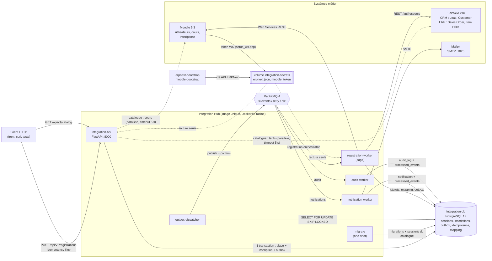
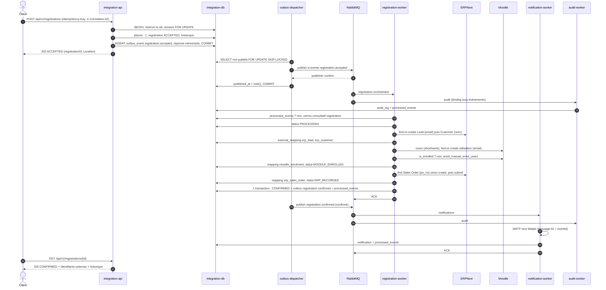
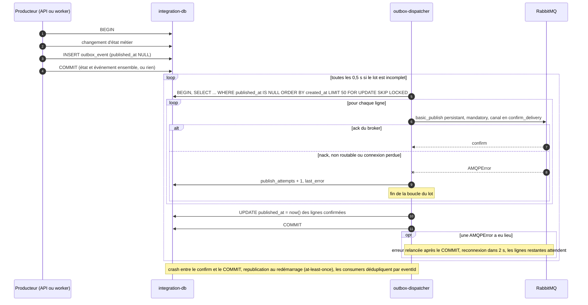
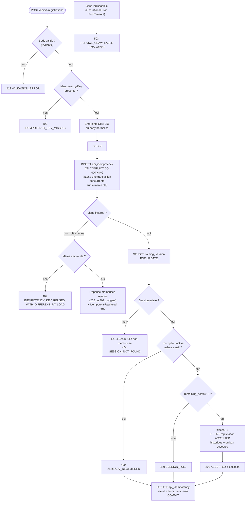
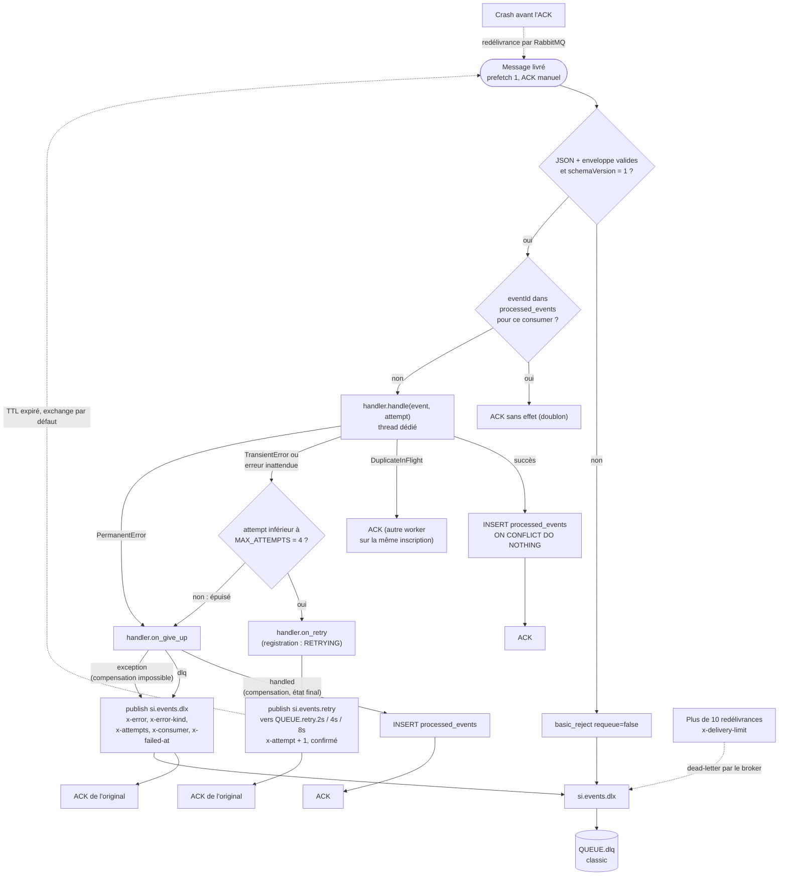
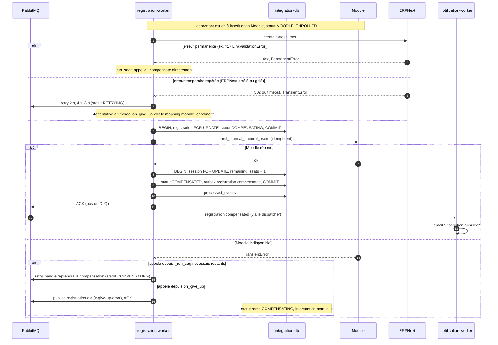
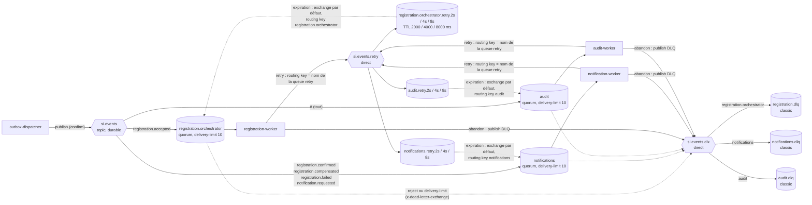

# Diagrammes Mermaid — OpenTraining

Ces diagrammes décrivent le code tel qu'il est. Le texte de référence est
[`docs/architecture.md`](architecture.md). Chaque diagramme indique les fichiers qu'il représente.

1. [Architecture](#1-architecture)
2. [Séquence : happy path](#2-séquence--happy-path)
3. [Séquence : Transactional Outbox](#3-séquence--transactional-outbox)
4. [Idempotence HTTP](#4-idempotence-http)
5. [Consumer idempotent, retry et DLQ](#5-consumer-idempotent-retry-et-dlq)
6. [Machine à états d'une inscription](#6-machine-à-états-dune-inscription)
7. [Séquence : compensation](#7-séquence--compensation)
8. [Topologie RabbitMQ](#8-topologie-rabbitmq)

---

## 1. Architecture

Sources : `docker-compose.yml`, `shared/rabbit.py`, `workers/*/main.py`.

---

## 2. Séquence : happy path

Sources : `integration-api/app/registrations.py`, `workers/outbox/main.py`, `shared/consumer.py`,
`workers/registration/processor.py`, `workers/notifications/main.py`, `workers/audit/main.py`.

---

## 3. Séquence : Transactional Outbox

Sources : `shared/events.py` (`insert_outbox`), `workers/outbox/main.py` (`dispatch_batch`, `run`),
`shared/rabbit.py` (`publish_event`).

---

## 4. Idempotence HTTP

Sources : `integration-api/app/routes/registrations.py`, `integration-api/app/registrations.py`.

---

## 5. Consumer idempotent, retry et DLQ

Source : `shared/consumer.py` (`_process`, `_give_up`, `_finish`), utilisé par les trois workers.

---

## 6. Machine à états d'une inscription

Sources : `migrations/001_init.sql` (CHECK des statuts), `integration-api/app/registrations.py`
(`ACCEPTED`), `workers/registration/processor.py` (toutes les autres transitions).

```mermaid
stateDiagram-v2
    [*] --> ACCEPTED: API, place réservée (202)

    ACCEPTED --> PROCESSING: début de tentative
    RETRYING --> PROCESSING: retour du message retry
    PROCESSING --> PROCESSING: redélivrance après crash
    MOODLE_ENROLLED --> PROCESSING: redélivrance après crash
    ERP_RECORDED --> PROCESSING: redélivrance après crash

    PROCESSING --> MOODLE_ENROLLED: inscription Moodle + mapping
    MOODLE_ENROLLED --> ERP_RECORDED: Sales Order créé et soumis
    ERP_RECORDED --> CONFIRMED: CONFIRMED + outbox confirmed + processed_events

    ACCEPTED --> RETRYING: erreur temporaire avant la saga
    PROCESSING --> RETRYING: erreur temporaire, essais restants
    MOODLE_ENROLLED --> RETRYING: erreur temporaire ERPNext, essais restants
    ERP_RECORDED --> RETRYING: erreur temporaire (base), essais restants

    MOODLE_ENROLLED --> COMPENSATING: erreur permanente Sales Order, ou essais épuisés
    COMPENSATING --> COMPENSATING: désinscription Moodle en erreur temporaire, retry
    COMPENSATING --> COMPENSATED: désinscription Moodle, place libérée, outbox compensated

    PROCESSING --> COMPENSATING: essais épuisés, mapping moodle_enrolment déjà présent

    PROCESSING --> FAILED: erreur permanente ou essais épuisés, sans inscription Moodle
    RETRYING --> FAILED: dernier essai en échec avant PROCESSING

    CONFIRMED --> [*]
    COMPENSATED --> [*]
    FAILED --> [*]

    note right of COMPENSATING
        Si la désinscription reste impossible
        après les retries, le message part
        en registration.dlq et le statut
        reste COMPENSATING (intervention manuelle)
    end note

    note right of FAILED
        Place libérée, outbox failed,
        désinscription Moodle best-effort,
        message conservé en registration.dlq
    end note
```

Remarques :

- `on_retry` ne modifie jamais un statut final ni `COMPENSATING`.
- Une inscription abandonnée par le broker (`x-delivery-limit`) garde son statut non final. Ce cas
  n'est pas une transition du code, il n'apparaît donc pas dans le diagramme.
- `RETRYING --> FAILED` correspond à une dernière tentative qui échoue avant `_run_saga`, par exemple
  sur un secret absent ou une base indisponible. Le chemin courant vers `FAILED` passe par `PROCESSING`.
- `PROCESSING --> COMPENSATING` se produit quand une tentative reprise après un crash échoue avant
  d'avoir réécrit `MOODLE_ENROLLED`, alors que le mapping `moodle_enrolment` existe déjà.

---

## 7. Séquence : compensation

Sources : `workers/registration/processor.py` (`_run_saga`, `on_give_up`, `_compensate`, `_finalize`),
`shared/consumer.py`.

---

## 8. Topologie RabbitMQ

Source : `shared/rabbit.py` (`declare_topology`, `_CONSUMER_QUEUES`, `_DLQS`, `RETRY_DELAYS`,
`DELIVERY_LIMIT`). Au total : 3 exchanges et 15 queues.

| Élément | Arguments déclarés |
|---|---|
| Queues consumer | `x-queue-type=quorum`, `x-dead-letter-exchange=si.events.dlx`, `x-dead-letter-routing-key=<queue>`, `x-delivery-limit=10` |
| Queues retry | `x-message-ttl` = 2000, 4000 ou 8000, `x-dead-letter-exchange=""`, `x-dead-letter-routing-key=<queue>` (type par défaut du vhost) |
| DLQ | `x-queue-type=classic` |
